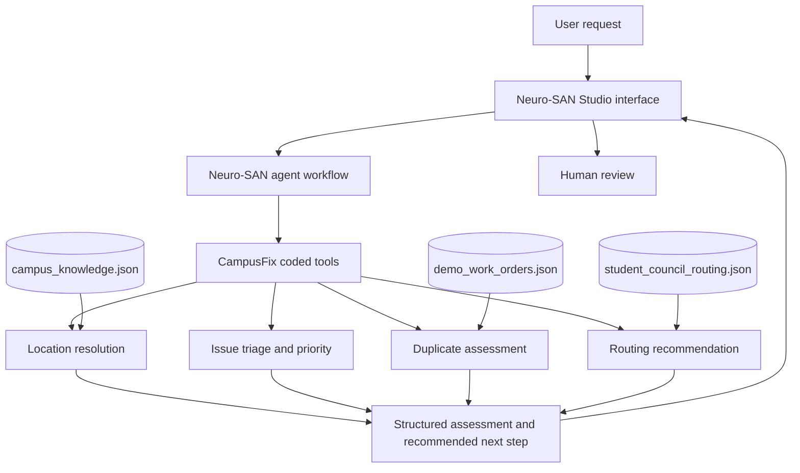

# CampusFix — System Architecture

## 1. Overview

CampusFix is an AI-assisted campus maintenance intake prototype built using the Neuro-SAN agent framework. It processes free-text maintenance reports and produces a structured assessment with a proposed Student Council routing path for human review.

The system combines agent orchestration, deterministic Python rules, and locally configured JSON data. Neuro-SAN coordinates the workflow, while CampusFix coded tools perform specific assessment tasks.

The prototype is designed to demonstrate how an agentic workflow can support campus maintenance intake without claiming to replace campus authorities or a live maintenance management system.

## 2. Architecture Goals

CampusFix is designed around the following goals:

- **Structured intake:** Convert unstructured complaint descriptions into useful assessment results.
- **Location awareness:** Resolve reported locations against configured campus knowledge.
- **Consistent assessment:** Apply documented rules to classify issues and estimate priority.
- **Duplicate awareness:** Identify possible matches in synthetic demo work orders.
- **Routing assistance:** Recommend eligible Student Council recipients according to configured routing rules.
- **Human oversight:** Present recommendations for review rather than automatically dispatching staff.
- **Separation of concerns:** Keep agent configuration, Python logic, and data files separate.

## 3. High-Level Architecture

The system has four main layers:

1. **User interaction layer:** The Neuro-SAN Studio interface through which users submit requests and receive responses.
2. **Agent orchestration layer:** A Neuro-SAN agent network configured through HOCON.
3. **CampusFix tool layer:** Custom Python coded tools and deterministic rules for complaint assessment.
4. **Data layer:** JSON files containing campus knowledge, synthetic demo work orders, and routing policy.

### Architecture Diagram



The diagram represents the intended logical flow of the prototype. It does not imply that every request invokes every assessment function; the actual tool calls depend on the request and configured agent workflow.

## 4. Neuro-SAN Integration

Neuro-SAN is the core orchestration framework used by CampusFix. The agent network is described in a HOCON registry rather than implementing all orchestration logic directly in application code.

The configuration connects the agent workflow to the CampusFix coded-tool interface. This allows the agent to coordinate the supported operations while the Python implementation handles structured rules and data access.

The main integration components are:

- **HOCON registry:** Defines the agent workflow and its tool configuration.
- **Coded-tool interface:** Exposes CampusFix operations to the Neuro-SAN runtime.
- **Python assessment rules:** Provide deterministic behavior for supported classification, location, duplicate, and routing tasks.
- **Model configuration:** Supplies the model-provider settings required by the authorized runtime.

The registry is located at:

`backend/registries/campusfix.hocon`

The exact model provider, environment-variable names, and runtime launch procedure should be verified against the configuration and authorized Neuro-SAN environment before deployment.

## 5. CampusFix Coded Tools

The CampusFix Python implementation is located in:

`backend/coded_tools/campusfix/`

### `campusfix_tools.py`

This module provides the coded-tool integration used by the agent workflow. It exposes supported CampusFix operations through the Neuro-SAN coded-tool interface and returns results in a structured, readable form.

Supported operations include tasks related to:

- Resolving a reported location.
- Assessing a maintenance complaint.
- Checking for possible duplicates.
- Producing a routing recommendation.
- Assessing or verifying supported information.

The exact operation names and parameters are defined by the implementation and should be consulted when extending the tool.

### `campusfix_rules.py`

This module contains deterministic Python rules used for structured assessment.

Keeping these rules separate from the agent configuration makes the logic easier to inspect, test, and maintain. Rule-based outcomes are constrained by the supplied knowledge, matching logic, and policy configuration.

A keyword-based assessment is not proof of a real-world condition. For example, a priority or hazard flag indicates that a report may require attention; it does not establish that an on-site inspection has confirmed the issue.

## 6. Data Layer

CampusFix uses JSON files stored under `backend/data/`.

| File | Purpose |
|---|---|
| `campus_knowledge.json` | Supplies configured campus location knowledge used during location resolution and related queries. |
| `demo_work_orders.json` | Provides synthetic example records for duplicate assessment. |
| `student_council_routing.json` | Defines the routing rules used to propose eligible Student Council recipients. |

### Data Handling Principles

- Demo work orders are synthetic fixtures, not records from a live campus maintenance system.
- Duplicate assessment is limited to the supplied local demo data.
- Location resolution depends on the configured campus knowledge.
- Routing recommendations depend on the configured policy and available role definitions.
- Data files should be reviewed before public distribution to ensure that they contain no personal, confidential, or otherwise restricted information.

## 7. Complaint Processing Workflow

The intended complaint-processing workflow is as follows.

### Step 1 — Receive a Request

A user submits a maintenance complaint or asks a direct campus-location question through the Neuro-SAN Studio interface.

### Step 2 — Interpret the Request

The agent workflow determines which supported operation is relevant and coordinates the appropriate CampusFix tool.

### Step 3 — Resolve the Location

When applicable, the tool compares the reported location against the configured campus knowledge and returns a resolution result.

If a location cannot be resolved confidently, the result should not be treated as a verified location.

### Step 4 — Assess the Issue

For maintenance complaints, the configured Python rules classify the issue using documented keyword-based logic and assess priority or possible safety concerns.

These outputs are preliminary assessments intended to support human review.

### Step 5 — Check for Possible Duplicates

The tool compares the complaint with the available synthetic demo work orders and identifies possible matches according to the implemented matching rules.

A possible match is an indication for review, not proof that two reports describe the same incident.

### Step 6 — Recommend a Routing Path

When applicable, the system uses the configured Student Council routing policy to propose eligible recipients or a next step.

The result is a recommendation. It does not constitute an assignment accepted by a real person or a dispatch instruction to maintenance staff.

### Step 7 — Return the Assessment

The system returns the available findings and recommended next step through the user interface. A human remains responsible for reviewing the output and deciding what action to take.

Not every request necessarily requires all the steps above.

## 8. Configuration and Repository Structure

The submission separates the coded tools, data, registry, and documentation.

```text
CampusFix-Submission/
├── backend/
│   ├── coded_tools/
│   │   └── campusfix/
│   │       ├── __init__.py
│   │       ├── campusfix_tools.py
│   │       └── campusfix_rules.py
│   ├── data/
│   │   ├── campus_knowledge.json
│   │   ├── demo_work_orders.json
│   │   └── student_council_routing.json
│   ├── registries/
│   │   └── campusfix.hocon
│   ├── requirements.txt
│   └── README.md
├── frontend/
│   └── README.md
├── .env.example
├── .gitignore
├── THIRD-PARTY-NOTICES.md
├── README.md
├── architecture.md
└── summary.md
```

The `frontend/` directory documents the current interface arrangement. The submission does not include a separate custom frontend application; the prototype currently uses the Neuro-SAN Studio interface.

## 9. Safety, Privacy, and Human Oversight

CampusFix is intended as an intake and decision-support prototype.

Its safety boundaries include:

- **Human review:** Routing and assessment results are proposals, not authoritative decisions.
- **No live dispatch:** The prototype does not send staff notifications or initiate maintenance work.
- **No live persistence:** Complaints are not saved as live work orders by the current implementation.
- **Synthetic demo data:** Duplicate checking uses local synthetic examples rather than a live maintenance database.
- **Limited inference:** Keyword-based rules cannot verify actual on-site conditions.
- **Configuration dependence:** Incorrect or incomplete location knowledge and routing policies can produce incomplete or inappropriate recommendations.

Immediate hazards must be reported directly to the appropriate campus authority. Users should not wait for an automated assessment before seeking help.

## 10. Current Limitations and Future Work

### Current Limitations

- No integration with a live campus maintenance database.
- No persistent work-order lifecycle or status tracking.
- No automatic staff notification or dispatch.
- Duplicate detection is limited to the available synthetic records.
- Assessment quality depends on the implemented rules and configured data.
- The end-to-end runtime procedure must be verified in the authorized Neuro-SAN environment.

### Potential Future Improvements

- Integrate an approved maintenance database with appropriate access controls.
- Add persistent work-order tracking and audit history.
- Introduce a human approval step before confirmed routing.
- Improve duplicate matching and evaluate it against a larger synthetic test set.
- Add automated tests for location resolution, classification, priority, and routing.
- Evaluate the workflow using documented test scenarios and measurable assessment criteria.
- Develop a dedicated frontend if the project requirements justify it.

These are potential extensions, not features currently claimed by the prototype.

## 11. Summary

CampusFix demonstrates how Neuro-SAN orchestration can be combined with custom coded tools, deterministic Python rules, and structured JSON data to support campus maintenance intake.

Its contribution is a modular workflow for location resolution, issue assessment, duplicate awareness, and routing recommendations. By keeping the prototype's limitations explicit and retaining human oversight, CampusFix provides a foundation for evaluating agent-assisted maintenance intake without misrepresenting the system as a live operational service.